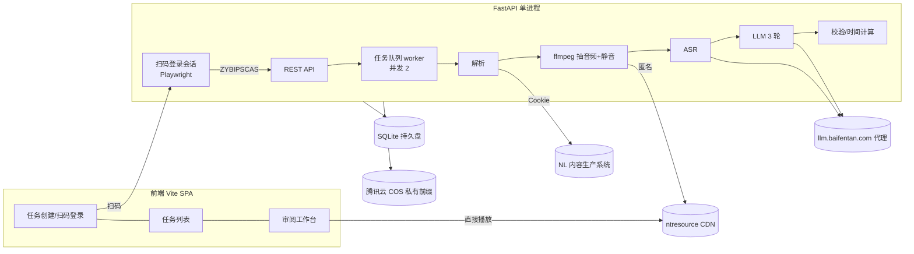

# 小数 AI 课自动打点 —— 开发方案

> 版本：v1（2026-11-07）。基于部署规范 [部署要求.md](./部署要求.md)、抽题规则 [prompt样例.md](./prompt样例.md) 与参考项目 ZYBmdshare。

## 1. 目标与范围

输入一批“NL 内容生产系统”的**视频素材 ID**（`resourceType=2`），系统自动：

1. 以本次任务的登录态解析 ID → 视频 URL；
2. 抽取音频 → ASR（分段 + 词级时间戳）→ 静音检测；
3. 按抽题规则调用 LLM，输出“时间点 / 问题 / 答案”打点；
4. 在审阅工作台中定位试听、校准、增删改；
5. 导出 Excel（工作表“问题抽取”，四列）与 UTF-8 BOM CSV。

不在范围：AI 课（type=5）、学习笔视频（type=12）、写回原系统、用户账号体系。

规模假设：单视频一般 ≤20 分钟，最长 30 分钟（硬上限 40 分钟）；最多 5 人同时使用。

## 2. 已验证的外部事实

| 项 | 结论 | 验证方式 |
| --- | --- | --- |
| 登录 | 统一登录 `ips.yukework.com/static/cas-fe`，支持钉钉扫码；无头 Chromium 可截取二维码，扫码后得到 Cookie | PoC `poc.py login` 实测成功 |
| 必需 Cookie | 仅 `ZYBIPSCAS`（HttpOnly，约 30 天）即可调用接口；`ZYBIPSUN`、`IPS_BL` 非必需 | 逐个 Cookie 实测 |
| 未登录响应 | `errNo=200002 "没有登录"`，`data.loginUrl` 为登录地址 | curl 实测 |
| ID → 素材 | `POST https://iot-admin.yukework.com/iot-content-backend/backend/resource/list`，`keyword=<ID>` 精确命中；取 `resourceType`、`realName`、`resourceUrl`、`resourceDuration(ms)` | PoC `resolve` 实测 |
| 视频地址 | `ntresource.cdnjtzy.com` 的 mp4，**匿名可访问**，支持 Range，`Access-Control-Allow-Origin: *`；另有 240p m3u8（`encodeUrl`） | curl 实测 |
| 抽音频 | `ffmpeg -i <URL>` 直接流式抽取，400 秒视频约 15 秒完成 | PoC 实测 |
| 静音 | 视频经剪辑，400 秒仅 2 处 ≥1 秒的停顿（-35dB）；**静音不能单独作为互动证据**，只用于时间点吸附与辅助判断 | PoC 实测 |

结论：**只有“解析 ID”这一步需要登录**；下载、ASR、播放都不依赖登录态。

## 3. 总体架构



技术栈（遵循部署规范）：Python 3.9+、FastAPI、uvicorn、SQLAlchemy + SQLite、Playwright（Chromium headless shell）、ffmpeg/ffprobe、openpyxl、cos-python-sdk-v5；前端 Node 20+、Vite + Vue 3（或 React）。

## 4. 登录方案（每任务一次登录）

1. 用户在“新建任务”页点击“扫码登录”，后端启动一个 Playwright 无头会话，打开 `fe-ctpsystem/` → 切换“钉钉扫码” → 截取 `iframe[src*=login.dingtalk.com]` 区域，返回二维码 PNG（base64）及 `login_session_id`。
2. 前端每 2 秒轮询 `GET /api/login-sessions/{id}`；后端检测到 Context 中出现 `ZYBIPSCAS` 即成功，关闭浏览器。二维码过期（约 2 分钟）可点“刷新”重新截取。
3. 兜底：用户粘贴 Cookie 或“复制为 cURL”文本，后端用正则提取 `ZYBIPSCAS`。
4. 成功后立即用该 Cookie 调 `resource/list` 解析本批全部 ID，结果写入任务。之后流程不再使用 Cookie。
5. Cookie 用 `SECRET_KEY` 派生密钥（Fernet）加密，存入任务记录，仅用于“重新解析”；任务完成或 24 小时后清空。Cookie 不进入日志、不返回前端。

约束：同时最多 2 个扫码会话（内存约 150MB/个），5 分钟无扫码自动关闭。

## 5. 处理流水线

| 阶段 | 实现 | 产物（COS） |
| --- | --- | --- |
| resolve | `resource/list`；非视频、未找到、无 URL 直接失败 | 任务表字段 |
| probe | `ffprobe` 取真实时长，>40 分钟拒绝 | — |
| audio | `ffmpeg -i URL -vn -ac 1 -ar 16000 audio.wav` | `audio.mp3`（48kbps，供复用） |
| silence | `silencedetect`，阈值 = 平均音量 −15dB（下限 −45dB），最短 0.5s | `silences.json` |
| asr | 按 20 分钟切片，`/audio/transcriptions`，`verbose_json` + segment/word 时间戳，换算全局时间 | `transcription.json` |
| evidence | 生成“`[s12] 00:01:02.300-00:01:05.900 文本` + `<停顿 1.2s>`”证据稿 | `evidence.txt` |
| llm | 3 轮（见第 6 节） | `llm_raw.json` |
| finalize | 锚点 → 时间、答案规范化、原话匹配度、去重、范围校验 | 打点表（DB） |

重试与缓存：每阶段产物存在即跳过，失败可从失败阶段重试；“重新抽题”只重跑 llm 与 finalize。

## 6. 抽题 Prompt 拆分（职责划分）

原对话式 prompt 拆为“代码确定性部分 + 模型语义部分”：

| 原步骤 | 新归属 |
| --- | --- |
| 1 核验输入 / 转写 | 代码 |
| 2 第一轮候选发现 | LLM 第 1 轮（输出 items + excluded） |
| 2 第二轮漏题回扫 | 代码找出未覆盖的互动指令词 / 问句+长停顿 → LLM 第 2 轮逐个判断；题量不足 `ceil(秒/60)` 时要求完整回扫 |
| 3–5、7 收录、去重、问题文字、答案规则 | 保留原文写入系统提示词 |
| 6 时间点 | LLM 只输出 `anchor_segment` + `anchor_text`；代码用词级时间戳求末字结束时间，并吸附 0.8 秒内的静音起点 |
| 8–9 题量与逐题复核 | LLM 第 3 轮复核 + 代码校验（原话匹配度 <70%、时间越界、相邻 <2 秒、答案空 → 标记待复核） |
| 10 文件生成与验证 | 代码（导出后重新打开校验） |

LLM 输出结构：

```json
{"items":[{"question":"","answer":"","anchor_segment":"s12","anchor_text":"选一选吧",
  "answer_segment":"s14","answer_evidence":"正确答案是C选项","needs_review":false,"review_reason":""}],
 "excluded":[{"segment":"s3","text":"","reason":""}]}
```

答案规范化：`C选项`、`选C`、`C（1000）` → `C`；仅在老师明确说出字母时适用（由 `answer_evidence` 校验含字母）。

### 6.1 Prompt 的两层结构

| 层 | 内容 | 是否暴露给用户 |
| --- | --- | --- |
| 抽题规则（可编辑） | 默认取 [prompts/default.md](../prompts/default.md)：由 [prompt样例.md](./prompt样例.md) 去掉文件路径、工具、Excel/CSV 生成与回复格式等“对话执行”内容后得到 | 是 |
| 系统约定（固定） | 输入格式（分段编号、`<停顿>`）、锚点输出（`anchor_segment`/`anchor_text`）、JSON 结构、每轮任务说明 | 否，由代码追加在规则之后，且声明优先级更高，保证用户改规则后结果仍可解析 |

### 6.2 Prompt 暴露、调整与重新生成

- **新建任务**：输入视频 ID 的同一页展示“抽题规则”编辑框，默认填充当前默认规则；可直接修改，本次修改只作用于本任务，不影响默认规则。提供“恢复默认”和“与默认对比（diff）”。
- **默认规则管理**：设置页可编辑默认规则，每次保存产生新的默认版本（旧版本保留、可回滚）。
- **重新生成**：在审阅页点击“修改规则并重新生成”，弹出编辑框（预填该视频当前版本所用的规则），提交后只重跑 LLM 3 轮和校验，复用已有音频、ASR、静音结果，约 20 秒；可对单个视频或整个任务批量执行。
- **生成版本**：每次生成（首次或重新生成）产生一个新的不可变“生成版本” `v1, v2, …`，记录：所用规则全文、模型名、ASR 模型、创建时间、题数、AI 原始输出。
- **版本切换**：审阅页顶部版本下拉框可切换查看任意版本；可“与上一版本对比”（新增/删除/时间或答案变化的题高亮）。
- **工作版本**：每个视频有且只有一个“当前工作版本”，人工编辑、确认、导出都基于它。新版本生成完成后不会自动覆盖人工成果：
  - 若当前版本尚无人工修改，自动切换到新版本；
  - 若已有人工修改，提示“设为当前版本”或“保留当前版本”，由用户选择。
- **人工编辑**：作用于某个版本内的打点（版本内保存 AI 原值与人工值）；切换回旧版本可看到当时的人工结果。导出默认用当前工作版本，可选择导出指定版本。

## 7. 审阅工作台

布局：左侧视频播放器 + 时间轴打点标记 + 当前时间附近逐字稿；右侧打点列表。

- 视频直接播放 CDN mp4（支持拖动），失败时回退 240p m3u8（hls.js）。
- 点击行：`currentTime = time − preroll` 并播放；`preroll` 默认 **1 秒**，页面可调，存 localStorage。
- 键盘：`空格` 播放/暂停，`←/→` ±1 秒，`Shift+←/→` ±0.1 秒，`Enter` 用当前时间写入选中行，`N` 以当前时间新增。
- 行操作：编辑问题/答案、写入当前时间、确认、删除（软删除，可撤销）；新增行来源标记为 `manual`。
- 行状态：待确认 / 已确认；显示 `review_reason`（模型或校验原因）。
- 自动保存：每次修改即 `PATCH`，带 `revision` 乐观锁；冲突时提示刷新（多人共用场景）。
- 导出：全部未删除行；存在未确认行时弹窗提示数量，确认后导出。支持单视频或整个任务（多视频合并）导出。

## 8. 数据模型（SQLite）

```text
task(id, name, status, created_at, cookie_enc, cookie_expire_at, prompt_text)
video(id, task_id, material_id, name, url, encode_url, duration_s, status, stage, error,
      artifacts_json, current_generation_id, created_at, updated_at)
generation(id, video_id, version_no, prompt_text, prompt_source[default|task|custom],
           default_prompt_id, model, asr_model, status, error, llm_raw_json,
           mark_count, has_manual_edits, created_at)
mark(id, generation_id, time_s, question, answer, status[pending|confirmed], deleted,
     source[ai|manual], ai_time_s, ai_question, ai_answer, review_reason, evidence,
     revision, updated_at)
default_prompt(id, version, content, created_at, active)
login_session(内存，不落库)
```

`ai_*` 字段保存模型原值，便于统计采纳率与人工改动幅度。

## 9. API

| 方法 | 路径 | 说明 |
| --- | --- | --- |
| GET | `/api/health` | 健康检查（部署验收） |
| POST | `/api/auth/login` | 共享访问口令 → HttpOnly 会话 Cookie |
| POST | `/api/login-sessions` | 启动扫码，返回 `{id, qr_png}` |
| GET | `/api/login-sessions/{id}` | `pending/success/expired`；可 `?refresh=1` |
| POST | `/api/tasks` | `{login_session_id \| cookie_text, material_ids[], name}`；同步解析并返回每个 ID 的结果 |
| GET | `/api/tasks`、`/api/tasks/{id}` | 列表/详情（含各视频阶段进度） |
| POST | `/api/videos/{id}/retry` | 从失败阶段重试 |
| GET | `/api/videos/{id}` | 视频信息、逐字稿、版本列表、当前版本打点 |
| POST | `/api/videos/{id}/generations` | `{prompt_text}` 重新生成新版本；任务级批量：`POST /api/tasks/{id}/generations` |
| GET | `/api/generations/{id}` | 某版本详情与打点；`?diff_with=` 对比 |
| POST | `/api/videos/{id}/current-generation` | `{generation_id}` 设为当前工作版本 |
| POST | `/api/generations/{id}/marks` | 新增打点 |
| PATCH | `/api/marks/{id}` | 修改（带 revision） |
| DELETE | `/api/marks/{id}` | 软删除；`POST /api/marks/{id}/restore` 恢复 |
| GET | `/api/export?task_id=` / `?video_id=` / `?generation_id=` | `format=xlsx\|csv`，默认当前工作版本 |
| GET/PUT | `/api/prompts/default` | 默认规则查看/保存新版本；`GET /api/prompts/default/versions` 历史 |

访问控制：无个人账号，使用共享口令 `APP_PASSWORD`（PBKDF2 存储，规范同部署文档的 `ADMIN_PASSWORD`）；`COOKIE_SECURE=true`。

## 10. 目录结构

```text
backend/
  main.py            # FastAPI app、静态前端挂载、/api/health
  config.py          # .env 加载与启动校验
  db.py models.py
  auth.py            # 共享口令
  ctp/login.py       # Playwright 扫码会话
  ctp/client.py      # resource/list
  pipeline/media.py asr.py llm.py finalize.py worker.py
  export.py
  storage.py         # COS / 本地（开发）
  prompts/default.md
frontend/            # Vite
scripts/
tests/
requirements.txt package.json .env.example
```

## 11. 配置（`.env.example`）

```dotenv
SECRET_KEY=
APP_PASSWORD=
DATABASE_URL=sqlite:///./data/app.sqlite
STORAGE_PROVIDER=cos
COS_REGION=ap-beijing
COS_BUCKET=
COS_PREFIX=ai-mark/
COS_SECRET_ID=
COS_SECRET_KEY=
AI_BASE_URL=https://llm.baifentan.com/openproxy/rp/v1
AI_MODEL=gpt-5.2
AI_API_KEY=
ASR_BASE_URL=
ASR_MODEL=whisper-1
ASR_API_KEY=
FFMPEG_BIN=ffmpeg
FFPROBE_BIN=ffprobe
WORKER_CONCURRENCY=2
MAX_VIDEO_SECONDS=2400
COOKIE_SECURE=true
TRUSTED_PROXY_CIDRS=
```

## 12. 部署

遵循 [部署要求.md](./部署要求.md)，额外一步安装无头浏览器：

```bash
python3 -m venv .venv
.venv/bin/python -m pip install -r requirements.txt
.venv/bin/python -m playwright install chromium-headless-shell   # 约 100MB，需外网
npm ci && npm run build
cp -n .env.example .env && chmod 600 .env
.venv/bin/python -m uvicorn backend.main:app --host 0.0.0.0 --port 8000
```

上线验收：`/api/health`；在部署机扫码登录并解析一个 ID；跑通 1 个视频；重启后任务与打点仍在；COS 对象匿名不可读。

部署风险：
- 部署机若缺少 Chromium 系统依赖（glibc 等），扫码登录不可用 → 自动降级为“粘贴 Cookie”，不影响其余功能。
- 部署机需访问 `iot-admin.yukework.com`、`ips.yukework.com`、`login.dingtalk.com`、`ntresource.cdnjtzy.com`、LLM 代理。

## 13. 里程碑

| 阶段 | 内容 | 验收 |
| --- | --- | --- |
| M0 PoC（已跑通） | `poc/poc.py`：扫码、解析、抽音频、静音、ASR、3 轮 LLM、版本化输出、导出 | 1 个视频人工评估：召回、答案正确率、时间偏差 |
| M1 后端骨架 | 配置、DB、口令、健康检查、扫码会话、任务创建与解析 | 部署机扫码+解析成功 |
| M2 流水线 | worker、各阶段缓存与重试、COS | 3 个视频批量跑通、重启续跑 |
| M3 审阅工作台 | 播放定位、时间轴、增删改、确认、导出 | 业务同事完成一次完整审阅 |
| M4 调优 | Prompt 模板管理、采纳率统计、ASR 模型对比 | 采纳率与时间误差达到约定指标 |
| M5 上线 | 部署、验收清单、备份 | 按第 12 节验收 |

## 14. 待确认 / 风险

1. whisper-1 已返回中文字/词级时间戳（400 秒视频 1463 个词，30 秒完成）；精度需人工试听评估，不达标时评估其他 ASR 模型。
5. PoC 首个样本（400 秒）抽出 3 题、目标 7 题：该段多为讲解，候选不足属正常，但需用更多样本评估召回。
2. 剪辑视频停顿少，模型对“作答机会”的判断更依赖语言线索（指令词、随后公布答案），需用样本评估。
3. `resource/list` 为内部接口，若改版需同步调整（集中在 `ctp/client.py`）。
4. 质量评估标准：需要业务方提供 2–3 个已人工打点的视频作为对照集。
